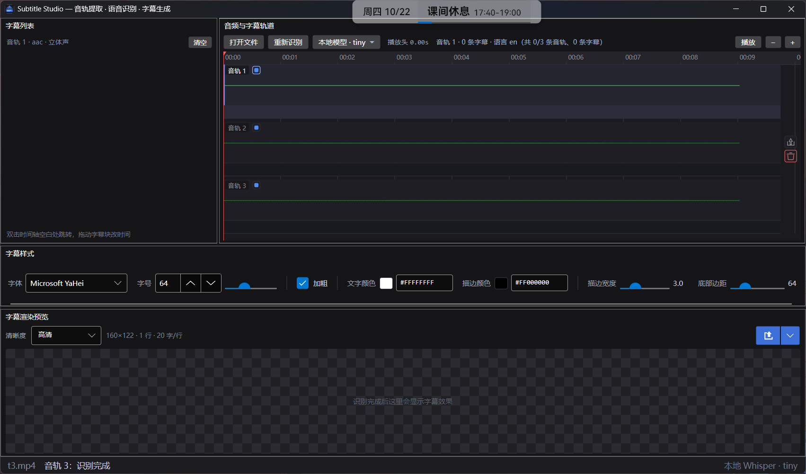

# SubtitleStudio

English | [简体中文](README.zh-CN.md)

Extract audio tracks from video → speech recognition → editable subtitles → render alpha-channel overlay videos or subtitle files.
Built with .NET 10 + Avalonia desktop + ffmpeg + whisper.cpp (Whisper.net).

> Developed by DeepSeek and Kimi K3.

## Download

The Releases page provides three packages:

| Package | Purpose |
|---|---|
| `SubtitleStudio-Setup-x.y.z.exe` | Installer: bundles ffmpeg and the tiny model. Installs per-user by default (no UAC prompt). |
| `SubtitleStudio-full.zip` | Portable full build: includes ffmpeg. Unzip and run `SubtitleStudio.exe`. No .NET installation required. |
| `SubtitleStudio-slim.zip` | Slim build: requires the .NET 10 Desktop Runtime and does **not** include ffmpeg. |

> **Slim build and ffmpeg:** ffmpeg is not bundled. On first launch (and whenever you try to open a video without it)
> the app shows a dialog with the official download page and a GitHub mirror. Put `ffmpeg.exe` and `ffprobe.exe`
> into `tools\ffmpeg\bin` next to the app (or add ffmpeg to `PATH`), then click “Recheck”.

The installer creates a Start menu shortcut (desktop icon optional) and can be removed from Settings → Apps.
User settings and imported fonts live in `%LOCALAPPDATA%\SubtitleStudio` and are kept after uninstalling.
The installer is not code-signed, so SmartScreen may warn on first run — click “More info → Run anyway”.

## Interface



Dock-style four-pane layout: drag pane titles to rearrange or dock them like VSCode, drag splitters to resize, and the layout is remembered.
The “Reset layout” button in the bottom bar restores the default arrangement in one click (panes have no close button, so a scattered layout can always be recovered):

```
┌───────────────┬──────────────────────────────────────┐
│ Subtitle list │ Timeline: one row per audio track     │
│ (fix typos)   │   waveform + subtitle bars below      │
│               │   click a row to switch to that track │
├───────────────┴──────────────────────────────────────┤
│ Style bar: font / size / color / outline / bottom gap │
├──────────────────────────────────────────────────────┤
│ Preview (checkerboard = transparent) + export menu    │
└──────────────────────────────────────────────────────┘
```

## Layout

```
SubtitleStudio/
├─ build.ps1                 # offline restore + build
├─ publish.ps1               # Release publish (self-contained) into dist/
├─ run.ps1                   # build and launch
├─ Directory.Build.props     # shared target framework, nullable, clean output settings (under src/)
├─ NuGet.config              # nuget.org by default; scripts switch to .tools\nuget-local when present
├─ models/                   # put ggml-*.bin here
├─ tools/ffmpeg/bin/         # put ffmpeg.exe / ffprobe.exe here
└─ src/
   ├─ SubtitleStudio.Core/   # UI-free: media, ASR, segmentation, subtitle output, alpha video rendering
   ├─ SubtitleStudio.Cli/    # command line: SubtitleStudio.Cli.exe (AssemblyName matches the project)
   └─ SubtitleStudio.App/    # Avalonia desktop app
```

### Layering conventions

* `Core` has no knowledge of Avalonia and never dispatches to a UI thread. Folders are split into `Models / Media / Asr / Subtitles / Export`, and each file does one job.
* The App's `AppState` is a `partial class` split by concern across five files:
  `AppState.cs` (state and derived properties), `AppState.Media.cs` (loading, waveform, track selection),
  `AppState.Recognition.cs` (audio extraction + ASR + segmentation), `AppState.Preview.cs` (preview rendering, timeline interaction),
  `AppState.Export.cs` (alpha video / subtitle export). Playback lives in `AppState.Playback.cs`.
* `Controls/TimelineControl` is also `partial`: `TimelineControl.cs` (properties and appearance constants),
  `.Render.cs` (ticks / waveform / subtitle blocks / playhead), `.Input.cs` (zoom, pan, drag, resize).
* `Panels.cs` only contains the shells of the four Dock panes (`SubtitleList/Timeline/Preview`); style editing lives in `StyleViewModel.cs`.
* Dialog and window events for each `View` live in companion files such as `.Dialogs.cs` / `DockChrome.cs` instead of piling into one file.

### Core highlights

* `Media/FfmpegTools` — one place to start and wait for ffmpeg/ffprobe; cancellation always kills the process before cleanup, so no orphan children.
* `Media/AudioExtractor` — `-map 0:<stream index> -vn -ac 1 -ar 16000 -c:a pcm_s16le`, so ASR always receives 16 kHz mono; failures return only the last few stderr lines.
* `Media/TempWorkspace` — extracted wav files go to `.subtitle-studio-tmp` next to the media; if that is not writable it falls back to the app directory / `%LOCALAPPDATA%` / `%TEMP%`.
* `Media/WaveformBuilder` — decodes audio to 8k s16le on stdout and computes min/max per second while streaming, for the timeline waveform.
* `Asr/WhisperLocalProvider` — Whisper.net streaming callbacks, emitting segments as recognition progresses.
* `Subtitles/CueSegmenter` — three-level splitting (“sentence-ending punctuation → comma-like → hard cut”), limited to 18 characters per line and 0.9–6 seconds.
* `Export/SubtitleLayerRenderer` — draws text with SkiaSharp and converts premultiplied alpha back to straight alpha (otherwise ffmpeg output has dark fringes); the font cache is capped at 16 entries and evicted as a batch.
* `Export/OverlayVideoExporter` — feeds raw BGRA frames per frame to ffmpeg's `rawvideo`, producing video with alpha.

## Build

Requires the .NET 10 SDK (to use .NET 9/8, change `TargetFramework` in `Directory.Build.props`).

```powershell
cd SubtitleStudio
.\build.ps1      # restore + build App and Cli
.\run.ps1        # build and launch
.\run.ps1 D:\videos\demo.mp4   # launch with a file, audio is extracted automatically; recognition starts only after you click Start recognition
```

You can also use dotnet directly:

```powershell
dotnet build src\SubtitleStudio.App\SubtitleStudio.App.csproj
dotnet run   --project src\SubtitleStudio.App
```

> Offline environments: if the parent of the repository contains `.tools\dotnet` (local SDK) and `.tools\nuget-local` (offline nupkgs),
> `build.ps1` / `publish.ps1` automatically use them and redirect temp directories and the NuGet cache into `.tools`.
> Without `.tools`, the scripts use the system dotnet and nuget.org (`NuGet.config` already points at nuget.org; no changes needed).

> The App uses `Services/CliBridge` to invoke the CLI for whisper recognition (killing the process cancels recognition).
> The CLI is located next to the App output directory under the matching configuration directory, so App and CLI must be built with the same `dotnet build` configuration.
> If you build only the App and not the Cli, the status bar shows “SubtitleStudio.Cli.exe not found”.

## Settings

Click “Settings” in the menu to open a separate window. Settings are stored in `%LOCALAPPDATA%\SubtitleStudio\settings.json` (falling back to `Documents\SubtitleStudio`, then `config` next to the app, then the temp directory; the `SUBTITLESTUDIO_SETTINGS` environment variable overrides the path).
Note that “not writable” is determined by actually writing a probe file: some security software / Controlled Folder Access allows creating a directory but blocks writing a file, and checking only directory existence would incorrectly report writable and settings would never be saved.

The left side of the settings window is a **provider list** (name + status dot: green = fully configured, red = missing something). **The whole row is clickable**; clicking a row switches the right side to that provider's form (there is no separate Edit button).
The “Add model provider” button at the bottom connects **any OpenAI-compatible recognition API** (`POST {base URL}/audio/transcriptions`): enter a name, base URL (the `/v1` level), API key, and model name.
“Test connection” does two things at once: verifies the key/URL and fetches `/v1/models`, caching the result and syncing it to the main window's model menu (custom providers are not filtered; everything is returned).
Custom providers appear in the model menu and can be removed with “Delete” at the end of the row (the three built-in providers cannot be deleted; deletion asks for confirmation).

All changes are **saved automatically when the window closes** (write and forget; there is no Cancel). The main window's position and size are also remembered on close and restored on the next launch —
if the screen environment changed (unplugged a monitor, changed resolution, DPI change), the size is clamped first and the visible area is checked; if too little of the window would be visible it falls back to a centered default instead of restoring off-screen.

> **Note: API keys are stored in plain text in settings.json.** Anyone or any program on this machine that can read your user directory can obtain the key.
> Be careful on shared or public computers, and revoke/reissue the key on the provider's platform immediately if it leaks.

- **SiliconFlow**: fixed base URL `https://api.siliconflow.cn/v1`. Enter the API key and click “Test connection”; connectivity and fetched models are reported together. The returned `/v1/models` is filtered to speech-recognition models (`type=audio` or a name containing sensevoice / whisper / asr / speech) and synced to the main window's model menu, so you do not need to pick a model in Settings.
- **TeleAI**: uses short-speech recognition at `POST https://api-maas.teleai.com.cn/aipaas/voice/v1/asr/short` and **only needs an API key** (`Authorization: Bearer sk-...`); no AppID / AppKey. The request body is `{req_id, audio_data(Base64 PCM), sample_rate, enable_punc, enable_itn}` and the response contains `result.sentences[]` (`begin_time` / `end_time` in milliseconds + `texts`). The official limit is one minute per request, so long audio is split into **58-second windows with a 2-second overlap**, recognized window by window, then stitched with shifted timelines. Sentences in the overlap belong to the window containing the overlap midpoint (first half to the previous window, second half to the next), so nothing is lost or duplicated. “Test connection” sends 0.5 seconds of silence; `code=10000` means the key works.
- **Local models**: lists all selectable whisper models (size + one-line description). The button has four states: never downloaded = “Download”, partially downloaded = “Continue”, downloading = “Stop”, installed = “Delete”.
  Before downloading, all mirrors are probed concurrently (a response within 4 seconds counts as reachable); reachable mirrors are tried in latency order and unreachable ones last (a blocked HEAD does not mean GET is blocked), and if all fail each error is reported. HTTP Range resumes are supported;
  closing the Settings window keeps the download running, and after a restart an unfinished `.part` file resumes automatically. Default mirrors are HuggingFace → HF mirror → ggml-org; the `SUBTITLESTUDIO_MODEL_MIRRORS` environment variable overrides them (semicolon-separated, `{file}` is replaced with the file name), for example an internal mirror:

```powershell
$env:SUBTITLESTUDIO_MODEL_MIRRORS = "http://10.0.0.5/models/{file};https://huggingface.co/ggerganov/whisper.cpp/resolve/main/{file}"
```

Download integrity: data is first written to `model-name.part` (with a neighboring `.part.src` recording the source URL; switching mirrors clears stale fragments automatically).
When finished, the byte count is verified; a mismatch is reported and the old file is not overwritten. An existing complete model is reused and never downloaded again.

The bottom-left of the Settings window also has **“Denoise before recognition”** (on by default): when extracting audio, ffmpeg gets `highpass=f=80,afftdn=nf=-25`,
which removes rumble below 80 Hz and suppresses background noise. Clean material is unaffected, while noisy material is recognized noticeably better.

Command-line equivalents:

```powershell
SubtitleStudio.Cli.exe --download medium        # download a model through the mirrors
SubtitleStudio.Cli.exe --settings               # print current settings and the config file path
SubtitleStudio.Cli.exe --settings --set-backend siliconflow --set-key sk-xxx
```

## Model menu

The title-bar dropdown has several sections: **Local models** (a submenu listing models in `models/` with sizes), **SiliconFlow**, **TeleAI**, **custom providers** (one entry per provider added in Settings), and **Settings** at the end. If a cloud backend is selected before a key is configured, a one-time “Open settings” prompt appears; after that, switching is direct.

## Delete and clear

- The trash icon in the right gutter of each track (below the export icon) **deletes the entire audio track** (including its subtitles and waveform), with confirmation. Deleted tracks disappear from the timeline and list, and the remaining tracks are renumbered.
- “Clear” at the top right of the subtitle list clears only the current track's subtitles, also with confirmation.

## Timeline row height

Track rows **fill the panel height** (each row adapts between 30 and 96 DIP). When the window grows taller, waveforms and subtitle bars grow with it and no empty space is left at the bottom; when there are too many tracks to fit, the minimum row height is used.

## Button self-test

`tools\ui-test.ps1` drives the UI buttons with Windows UI Automation (independent of window position):

```powershell
powershell -ExecutionPolicy Bypass -File .\tools\ui-test.ps1 -Media test\test.mp4 -Shots .\shots
```

It covers: Start recognition (the button becomes “Re-recognize”), play/pause, zoom, clear (including the confirmation dialog), delete track (including confirmation), re-recognize, the Open file dialog, export audio, all six export formats, the model menu, and the Settings window (provider list + add/delete custom providers + auto-save). The script prints `OK/FAIL` and screenshot paths.

## Internationalization (i18n)

All UI text goes through `Loc.T("key")`; XAML uses `{DynamicResource L.Key}`. Switching languages refreshes the whole UI immediately without a restart.
To the right of the file name in the bottom bar are the language dropdown and “Reset layout”: Simplified Chinese / English, plus “More languages…”, which reopens the tile-based selection window.
On first run (no language saved yet and `SUBTITLESTUDIO_LANG` unset) the tile picker appears first; after a choice it no longer interrupts.

Language pack format (`src/SubtitleStudio.App/Assets/lang/*.json`):

```json
{
  "code": "ja",
  "name": "日本語",
  "strings": { "App.Title": "…", "Button.OpenFile": "…" }
}
```

To add a language, put such a JSON file in the `lang/` directory next to the app. It is merged at startup and appears in the dropdown and picker (the file name is the language code, but the `code` inside the file wins).
The `SUBTITLESTUDIO_LANG=ja` environment variable has the highest priority, overrides the saved choice, and skips the first-run picker; regional codes such as `zh-CN` are supported.
JSON must be UTF-8. A missing key displays the key itself (making omissions easy to spot); only an unknown language code falls back to Chinese.

## Color palette

The text color / outline color squares in the style bar are now buttons. Clicking one opens a full palette (hue bar + saturation/value panel + alpha + common colors); the preview updates immediately.
The adjacent hex input still accepts manual `#AARRGGBB` values.

## Hover buttons on tracks

Hovering a track reveals two 20×20 buttons on the right: the upper one exports that track's audio, the lower red one deletes the whole track.
The buttons are vertically centered within the track's “waveform + subtitle bar” height, so they do not become thin strips when a row grows taller.
Deleting first asks for confirmation, then removes the entire audio track and its subtitles.

## Cloud models

“SiliconFlow” and “TeleAI” are both submenus in the model menu. “Test connection” in Settings calls `/v1/models`,
keeps only speech-recognition models (`type=audio`, or a name containing sensevoice/whisper/asr/speech) and syncs them to the menu; TeleAI uses its official model list.
Both cloud backends share one `HttpClient`, but each request carries its own API key in the `Authorization` header, so keys never cross.

## Cloud ASR test results

The same clip (track 4 of `test/test.mp4`, 10 seconds of Chinese) was recognized successfully with both cloud backends:

| Backend | Result | Notes |
|---|---|---|
| SiliconFlow `FunAudioLLM/SenseVoiceSmall` | “噢噢噢。” / “这是一段测试音频，” / “应该可以识别出来这几句话。” | The API returns only the full text + `language`, **without sentence timestamps**; the timeline is estimated from character counts. |
| TeleAI `asr/short` | The same three sentences at `0.20–2.04` / `2.27–4.47` / `4.49–7.63` | Returns `begin_time`/`end_time` in milliseconds, so the timestamps are real. |

> TeleAI short speech is limited to one minute per request: long audio is analyzed with PCM energy first and cut preferably at **silence** (maximum 58-second windows, 2-second overlap).
> The overlap is assigned per cutting point — cuts fall in silence, so words are not split in half. SiliconFlow audio longer than 10 minutes uses the same cutting strategy.

## Packaging

```powershell
.\publish.ps1                  # full: self-contained, no .NET needed on the target machine (default)
.\publish.ps1 -Mode slim       # slim: framework-dependent, requires .NET 10 Desktop Runtime; ffmpeg is not copied
.\publish.ps1 -Zip             # also create a zip for distribution
.\publish.ps1 -NoModel         # do not bundle models (download them in Settings on first run)

.\installer.ps1                # build an installer from dist\SubtitleStudio
```

| Artifact | Path | Size |
|---|---|---|
| full directory | `dist\SubtitleStudio` | 362 MB |
| full zip | `dist\SubtitleStudio-full.zip` | 184 MB |
| slim directory | `dist\SubtitleStudio-slim` | 101 MB |
| slim zip | `dist\SubtitleStudio-slim.zip` | 77 MB |
| installer | `dist\SubtitleStudio-Setup-1.1.0.exe` | 150 MB |
| source zip | `dist\SubtitleStudio-1.1.0-source.zip` | 0.3 MB |

### Installer

`installer.iss` is compiled with Inno Setup 6.5+. `installer.ps1` reads the version from `src\Directory.Build.props` and locates `ISCC.exe` in common paths (use `-IsccPath` if it cannot find it):

* Installs per-user to `%LOCALAPPDATA%\Programs\Subtitle Studio` by default without UAC; the wizard also offers an all-users install.
* The installer bundles ffmpeg and the tiny model, so it works immediately after installation. A Start menu shortcut is always created; the desktop icon is optional.
* `AppId` is fixed, so newer installers upgrade in place. Uninstalling does not touch settings or fonts in `%LOCALAPPDATA%\SubtitleStudio`.
* The Simplified Chinese UI uses `tools\setup\ChineseSimplified.isl` (from the official Inno Setup language files), with English as fallback.

Size breakdown (full): `tools\ffmpeg` 186 MB + `models` 74 MB + .NET runtime and app 101 MB.

- **ffmpeg is the biggest part**: this uses the shared build (`ffmpeg.exe` + a set of `avcodec/avformat/avfilter/...` DLLs). A custom build with only the needed codecs could shrink it to 20–30 MB, at the cost of losing support for some input formats (the current build reads almost anything).
- **To go smaller**: `-Mode slim` saves the 74 MB runtime; `-NoModel` saves another 74 MB of models.
- Packaging also removes debug-only files such as `createdump.exe`, `Microsoft.DiaSymReader.Native`, and `*.pdb`, non-`win-x64` platform outputs under `runtimes`, and Avalonia backends unused on win-x64 (X11 / FreeDesktop / macOS Native, designer remote protocol). Despite its name, `Avalonia.Metal.dll` must be kept: Skia on Windows also references it; deleting it leaves only the title bar painted and the client area never redraws, which looks like a “transparent window”.
- The color palette is drawn in-house; the `Avalonia.Controls.ColorPicker` package is not used. Temporary wav files from preview playback can remain if the process is killed; at startup the app removes files older than one day so the install directory does not grow forever.

## Usage

1. Put ffmpeg in `tools/ffmpeg/bin/` (or add it to PATH). The slim build does not ship ffmpeg and prompts you to download it on first launch.
2. Put models in `models/`, for example `ggml-tiny.bin` / `ggml-medium.bin`.
3. Open the app → drop in a video → audio tracks are extracted automatically (recognition does not start automatically) → check the tracks to recognize and click “Start recognition” → edit text in the left list and drag blocks on the timeline.
4. Use the style bar to adjust font color and outline; the preview below updates live.
5. Export: WebM (VP9 alpha) / MOV (ProRes 4444) / MP4 (H.264, no transparency) / SRT / ASS / VTT.

### Fonts

Besides system fonts, the font dropdown has “+ Import other font…” as its last item. Pick a `.ttf/.otf/.ttc`;
the file is copied to `%LOCALAPPDATA%\SubtitleStudio\fonts` and survives restarts. Rendering (preview and export) loads directly from the font file;
installing it into the system font library is not required.

### Errors

When something goes wrong, a red message appears at the bottom left of the window, showing only the first few characters. Hover to expand the full message, click to copy it to the clipboard.

### Multiple audio tracks

When a video has several audio tracks, each track gets its own row on the timeline (labeled “Track 1 / 2 / 3”, followed by codec and language).
Each track is extracted, recognized, and subtitled independently. Click a row to switch to that track:

* The subtitle list on the left switches to that track's subtitles and can be edited directly.
* The preview below switches to that track's rendering.
* The checkbox to the right of each “Track N” label controls whether the track participates in recognition and export; unchecked tracks are skipped (skipping recognition does not clear existing subtitles).
* Hovering a row reveals two 20×20 buttons at the far right edge (they stay with the window, not scrolling with the timeline):
  the upper export arrow exports that track's audio to `.m4a`; the lower red trash can deletes the whole track (including subtitles, after confirmation).

Multi-track processing is serial and cumulative; the status bar shows `3/3 tracks, 3 subtitles`.

### Export size

Exported alpha videos **no longer match the original video frame**; they are cropped around the subtitle content:

* Width = the width of the longest subtitle line in that track + horizontal padding; height = line count × line height + vertical padding.
* A single subtitle longer than 20 characters is split during segmentation; line wrapping in the renderer uses 20 characters per line.
* The “Quality” control at the top left of the preview has three levels (Smooth / HD / Ultra), which determine render font size and final pixels.
  Next to it is the current track's export size, for example `226×122 · 1 line · 20 chars/line`.
* The preview canvas renders at the **video's real resolution** (longest side capped at 1920 so 4K stays responsive), showing subtitle placement within the full frame. Only export crops the surrounding empty space.

Because each track's subtitles differ in length, multi-track export produces **several videos with different sizes** — overlay them into other projects as needed.

### Buttons during recognition

After importing a file, **recognition does not start automatically**: the button in the “Audio and subtitle tracks” title bar reads “Start recognition” and only runs when clicked.
It **only recognizes checked tracks** (unchecked tracks are skipped and keep their existing subtitles). After a full run the button becomes “Re-recognize”;
stopping midway returns it to “Start recognition”.

During recognition, the title bar shows a **ring progress indicator** (always a ring, even in narrow windows) and a percentage, with an `✕` stop button next to the percentage:

* Clicking it during audio extraction interrupts ffmpeg immediately.
* Clicking it during recognition **ends the current track** (kills the whisper process and cleans temporary files); completed tracks are kept.

### Playback

“Play” produces actual sound (`NAudio` + ffmpeg first mix the checked tracks into a temporary wav, then play it).
The playhead follows real progress; click again to pause. If no track is checked, playback does not start and the status bar asks you to check one.
Changing the checkboxes (or deleting a track) stops playback and discards the prepared wav; the next Play re-mixes from the new selection.
This is for preview only; export is independent.

- Decoding/mixing can be cancelled: clicking play again or closing the file stops ffmpeg immediately with no orphan processes.
- Media longer than 30 minutes is decoded only for the first 30 minutes in preview (the status bar says “first 30 minutes only”), and dragging the playhead beyond that does not wait for decoding.

### Timeline interactions

* The red vertical line is the playhead: press/drag on empty timeline space and playback jumps there immediately (even while playing); double-clicking empty space also seeks.
* Subtitle blocks: drag the middle to move the whole block (changing start/end times), drag the left/right edges to stretch; blocks stop at neighboring subtitles and never overlap.
* Right-click a subtitle block to delete it; right-click an empty spot in the subtitle lane to add a subtitle at that position (2 seconds by default, clamped so it cannot overlap neighbors).
* Only one context menu is shown at a time: right-clicking somewhere else closes the previous one, and a left click on the timeline closes it too.
* Mouse wheel scrolls horizontally, Ctrl+wheel zooms anchored at the mouse position, middle-drag/Alt+left-drag pans, and the `−` / `+` buttons in the title bar also zoom.
* The subtitle list on the left shows only each subtitle's **midpoint time** (`MM:SS.mm`); edit text directly in the input field on the right.

### Models

The “Local model · tiny ▾” item in the title bar is the model menu:

* **Local models**: lists `ggml-*.bin` files under `models/`; click one to switch.
* Cloud channels (SiliconFlow / TeleAI): available only after a key is configured.
* **Model notes (size / download link)**: lists common models with sizes and HuggingFace links.
* **Open models folder**: jumps straight to the model directory.

### Recognition quality

After recognition, text goes through two processing layers before segmentation:

* `HallucinationFilter`: drops fabrications during silence (`[BLANK_AUDIO]`, `[MUSIC]`, `(applause)`, whole-segment repetition, abnormal speech rate);
  genuine sound annotations such as `[Bell]` are kept. Boilerplate rules (“subtitles by…”, “… subtitle group”) only match **whole sentences**, so normal dialogue containing those words is not killed by mistake.
* `PunctuationRestorer`: inserts commas/periods based on pauses between words (using real pauses when word timestamps exist, otherwise character-count heuristics); bracketed annotations get no punctuation.

## Command line

```powershell
SubtitleStudio.Cli --input video.mp4 --out out --format srt,vtt,ass --model models\ggml-tiny.bin
SubtitleStudio.Cli --input video.mp4 --out out --track 2          # only process audio track 2
SubtitleStudio.Cli --input video.mp4 --out out --overlay webm --width 1920 --height 1080 --fps 30
SubtitleStudio.Cli --input video.mp4 --waveform                   # print waveform stats per track
SubtitleStudio.Cli --models                                       # list installed + downloadable models
SubtitleStudio.Cli --input clip.wav --asr-json result.json        # recognize a wav and emit JSON (used internally by the App)
```

`--out` is a **prefix** and produces `out.srt` / `out.vtt` / `out.ass` / `out-overlay.webm`.
Multi-track files are processed track by track by default, with track numbers in file names: `out-t1.srt`, `out-t2.srt`, and so on.
`--overlay` uses subtitles from the first track (or the one selected with `--track`).

## Verification log

* CLI end-to-end (`testclip.mp4`, 6 seconds + `ggml-tiny.bin`): extract audio → recognize (1 segment) → segment (1 cue) → write srt/vtt/ass → render 180 frames → encode WebM, about 3 seconds total.
* CLI multi-track (`testclip3.mp4`, 1 video + 3 audio tracks): the three tracks recognized `[Bell]` / `[MUSIC]` / `[screaming]`, producing `clip-t1.srt` through `clip-t3.srt` in 2.8 seconds.
* GUI: launch → automatically load and extract three tracks (no automatic recognition) → click “Start recognition” → button becomes “Re-recognize” when done;
  clicking the “Track 2” row switches the list to `[MUSIC]`, the status bar to `Track 2 · 1 subtitle · language en`, and the preview to `[MUSIC]`.
* Real screen recording (`test/test.mp4`, 1920×1080@60, HEVC, 3 AAC tracks, 26.7 seconds): tracks recognized `[MUSIC]` / `[BLANK_AUDIO]` / `[BLANK_AUDIO]`; GUI export of a 1080p60 WebM succeeded, producing `test-t1-overlay.webm` (198 KB).
* Failure paths: exporting to an unwritable directory and an exclusively locked output file both show a message and exit without crashing; error text includes the original ffmpeg message (`Permission denied`).
* Size cropped to subtitles (`testclip3.mp4`): three tracks exported as `226×122`, `326×122`, and `440×122` WebMs; unchecking track 2 exports only t1 and t3.
* Per-track audio export: clicking the `↓` on the right of the first row produced `testclip3-t1.m4a` (137 KB).
* Stop recognition (`long.m4a`, 180 seconds, two tracks): clicking `■` during extraction stops immediately; during recognition it stops after the current track finishes, the status bar shows “Recognition stopped (completed tracks kept)”, and completed tracks keep their subtitles.
* Playback: after clicking “Play”, the playhead advances (2.52 s in the screenshot), the button becomes “Pause”, the status bar shows “Playing (checked tracks only)”, and audio is mixed by ffmpeg + NAudio and actually audible.
* Hover export: hovering the “Track 2” row shows `⤒` on the right; clicking it produced `testclip3-t2.m4a` (137 KB).
* Recognition quality: on `testclip3.mp4` only `[Bell]` and `[screaming]` remain (`[MUSIC]` is filtered as a silence annotation), and bracketed annotations no longer get trailing periods.
* Model menu: screenshots confirm the sections “Local models / Cloud channels (no key) / Model notes / Open models folder”.
* Stop recognition (`long.m4a`, 180 seconds): clicking `✕` during recognition interrupts the current track, the status bar shows “Recognition stopped (completed tracks kept)”, and the process survives without crashing.
* Unwritable export directory (pointing `SUBTITLESTUDIO_EXPORT_DIR` at `C:\Windows\System32\...`):
  the app automatically switches to a writable directory (trying `%LOCALAPPDATA%\SubtitleStudio\exports`, `Videos\SubtitleStudio`, `exports` next to the app, and `%TEMP%` in order), tells the user where it saved, and completes the export.
* Settings persistence (this machine has security software blocking unsigned programs from writing the user directory): when neither `%LOCALAPPDATA%` nor `Documents` is writable,
  settings fall back to `config\settings.json` next to the app, and `CLI --settings --set-backend` prints `[saved] ...\config\settings.json`;
  the Settings window saves automatically whether closed with “Done” or the × button (write and forget).
* Window position: moving the window to `(100,60) 1100×700` and closing it stores `WindowX/Y/Width/Height` in `settings.json`; after restart `GetWindowRect` reads back exactly the same values. If the screen cannot fit it, the size is clamped and visible area checked, so it never restores off-screen.

## Troubleshooting

* **Export / recognition failures**: a red message appears at the bottom left of the UI, showing the first few dozen characters. Hover for the full text, click to copy it to the clipboard. Errors include ffmpeg's own output (for example `Error opening output ... Permission denied`, `moov atom not found`) instead of just “pipe ended”.
* **Crash log**: every unhandled exception is written to `%LOCALAPPDATA%\SubtitleStudio\crash.log` instead of showing “application exception 0xe0434352”. The UI stays open (with a status bar message) when an exception occurs; share the log to diagnose.
* **Export directory**: set the `SUBTITLESTUDIO_EXPORT_DIR` environment variable to skip the folder picker and export to a fixed directory (for automation / batch processing).
* **Two causes of write failures**: the app actually writes a probe file to decide. If **permissions / Controlled Folder Access** are blocking, the bottom bar shows a “Restart as administrator” button;
  clicking it relaunches through UAC. If the limitation is at the system level (read-only disk, directory locked by another program), the reason and alternative directories are shown directly.

## Known limitations

* MP4/H.264 does not support an alpha channel; use WebM or ProRes 4444 for transparent subtitles.
* Cloud ASR channels require an API key (see `src/SubtitleStudio.Core/Asr/RemoteAsrProvider.cs` and `TeleAiClient.cs`).
* Long-video recognition is serial: it can be stopped midway, but restarting requires processing the whole clip again (completed tracks are preserved).
* Progress appears at the right of the “Audio and subtitle tracks” title bar as a **ring** and percentage during recognition (always a ring, regardless of window width).
* The “▾ menu” and “📌 pin” buttons in pane title bars are hidden; drag titles to move/dock (VSCode style), and click “Reset layout” in the bottom bar if the layout gets scattered.
* Export uses the source frame rate (encoding a 60 fps 1080p screen recording to VP9 is relatively slow: about 80 seconds for 27 seconds of footage).
  Export size is cropped to the subtitles, so the pixel count is much smaller than the original and it is faster than a full-frame export.
* Preview decodes only the first 30 minutes; API keys are stored in plain text in settings.json (see the note in Settings).

## Developer utilities

`tools/shot-window.ps1` captures a window like a screen recorder's window capture: it uses `DwmGetWindowAttribute`
for the real window bounds, brings the window to the foreground, then grabs the screen; if that fails it falls back to rendering via `PrintWindow`.

```powershell
.\run.ps1 ..\.tools\testclip3.mp4
.\tools\shot-window.ps1 -Out shot.png
```
